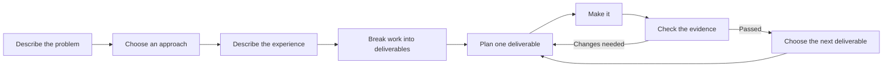

# Reusable Delivery Framework

Turn an idea into small pieces of work, make each piece, and check that it does what was promised.

This is a project starter for people working with AI assistants. It works for software, documents, internal processes, events, and other projects whose results can be checked. You choose the project and tools; the framework supplies the handoffs and quality checks.

**Start here:** [A guide for everyone](docs/start-here.md). No coding knowledge required.



Think of it as a set of labeled folders and instruction cards. Each card tells an AI assistant which files to read, what to produce, and how to check it. The folders let another person continue the work without remembering the whole conversation.

## Choose your starting point

| I want to… | Read this |
|---|---|
| Understand it without technical terms | [Start here](docs/start-here.md) |
| Try it without installing anything | [Your first project](tutorials/01-first-project.md) |
| See a finished, small example | [Community welcome guide](examples/community-event/README.md) |
| Use it for software or an existing project | [Adapt it to your project](tutorials/02-adapt-a-project.md) |
| Understand what was extracted and improved | [Framework analysis](docs/framework-analysis.md) |
| Learn what every file means | [File contracts](docs/file-contracts.md) |
| Improve AI instructions using evidence | [Evaluate and improve](tutorials/03-evaluate-and-improve.md) |
| Run the tools or fix a problem | [Technical setup](docs/technical-setup.md) · [Troubleshooting](docs/troubleshooting.md) |

## Optional command-line quick start

Requires Python 3.11 or newer. These commands work from this repository's root in a macOS/Linux terminal. Windows equivalents are in the [setup guide](docs/technical-setup.md).

```sh
python3 -m venv .venv
.venv/bin/python -m pip install -r requirements.txt
.venv/bin/python scripts/init_project.py my-project --name "My project"
.venv/bin/python scripts/validate.py --project examples/community-event --complete
.venv/bin/python -m unittest discover -s tests -v
```

The initializer creates `projects/my-project/` with a project card and three document templates. Fill these in with your assistant, then use `skills/decompose-to-deliverables/SKILL.md` to create the work list. Validation will report a missing work list until that step is done; initialization does not invent requirements.

## What is included

```text
skills/          Seven reusable instruction cards, each called SKILL.md
templates/       Starting points for documents and structured files
schemas/         Machine-readable definitions of the structured files
scripts/         Project creation, validation, and an example check
evaluations/     Checklists for judging AI output and difficult test cases
examples/        A complete document project and a software planning example
docs/            Simple explanations, analysis, and reference material
tutorials/       Three practical walkthroughs
tests/           Checks that the tooling catches broken handoffs
.github/         Automated checks and a pull request checklist
```

No AI subscription, API key, database, or web application stack is required by the framework. An assistant executes the instruction cards; the included Python tools create folders and check files. They do not call AI or run an autonomous delivery service.

All material in this repository is newly written. See [provenance](docs/provenance.md) for the source analysis and [LICENSE](LICENSE) for reuse terms.

See the [validation record](docs/validation-report.md) for checks performed and their limits.
